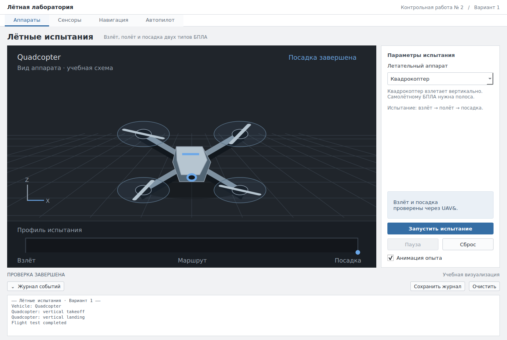
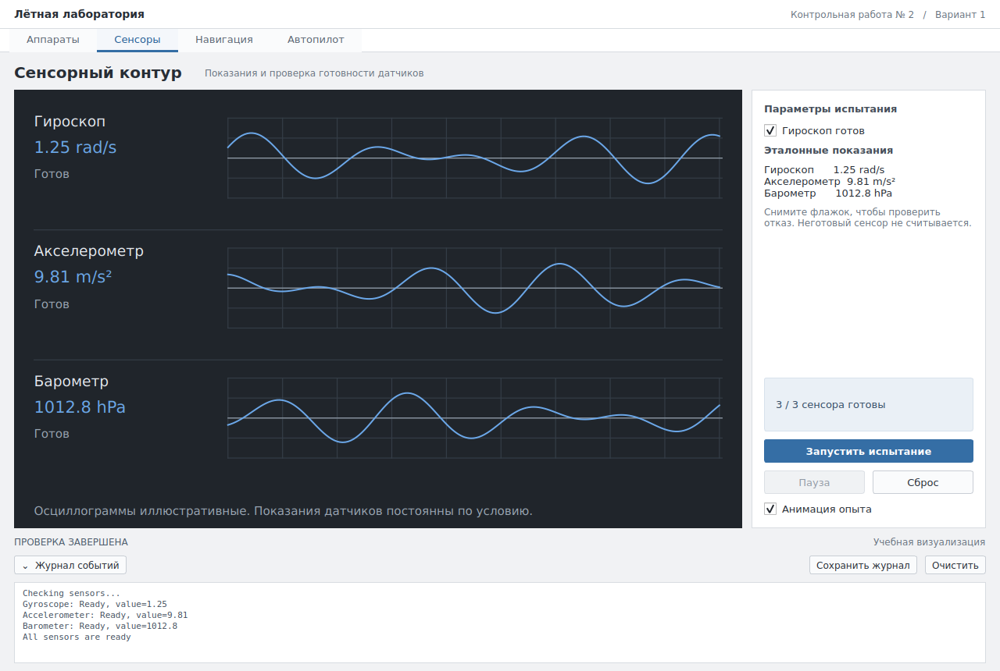
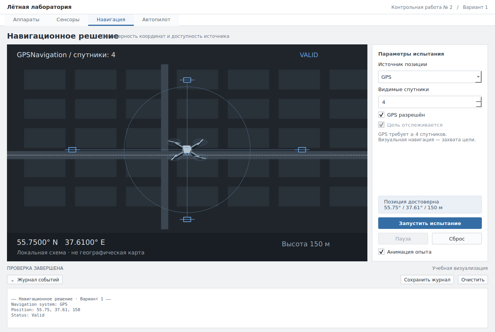
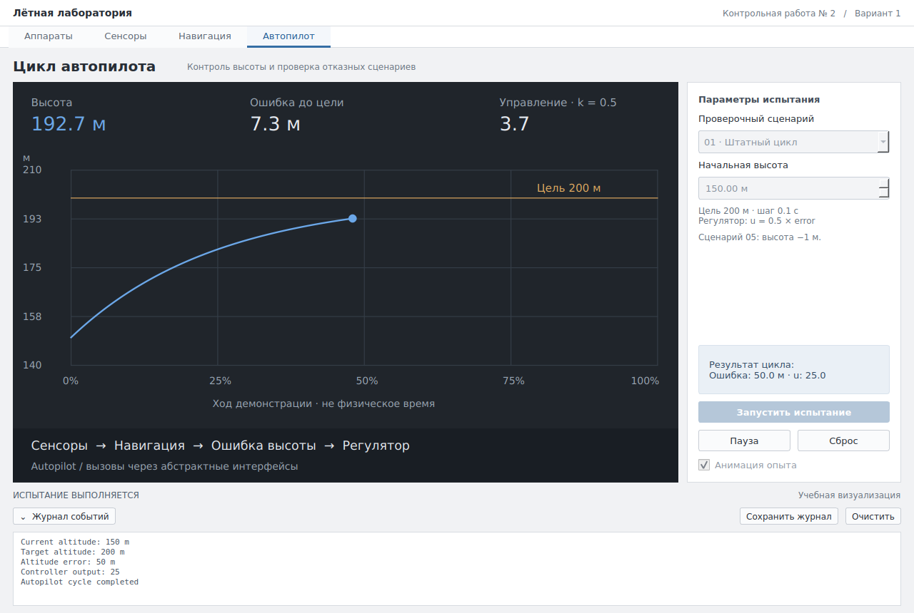

# Полётная лаборатория · Контрольная работа № 2

Самостоятельный проект **Control_Work_02_Polymorphism**, C++17 / Qt Widgets. Во всех трёх заданиях выполнен **вариант 1**, дополнительно реализовано общее интеграционное задание `Autopilot`. Условия: [Контрольная работа 2 ПО ОНИ.pdf](Контрольная%20работа%202%20ПО%20ОНИ.pdf).

## Интерфейс



<details>
<summary>Сенсоры, навигация и автопилот</summary>





</details>

## Запуск

Из корня репозитория:

```bash
git clone https://github.com/ukamaev37-ship-it/controlnaya2.git
cd controlnaya2
./run.sh
```

Если проект находится в общей папке учебных работ, сначала перейдите в `Control_Work_02_Polymorphism`.

Скрипт собирает приложение и запускает его. Нужны CMake, компилятор C++17 и Qt с модулями Widgets и Test.

Для Ubuntu / Debian установите зависимости:

```bash
sudo apt install build-essential cmake qtbase5-dev
```

Ручная сборка из каталога этого проекта:

```bash
cmake -S . -B build -DCMAKE_BUILD_TYPE=Release
cmake --build build -j2
./build/control_work_02
```

В Qt Creator откройте **этот** `CMakeLists.txt`, выберите Desktop kit и цель `control_work_02`. Интерфейс создаётся в C++, схемы рисуются через QPainter; файла `.ui` нет. CMake предусматривает Qt 5/6; переносимость на Windows и Qt 6 требует отдельной проверки.

Если системный `ccache` недоступен для записи, укажите обычный компилятор: `cmake -S . -B build -DCMAKE_CXX_COMPILER=/usr/bin/g++`. Скрипт запуска очищает переменные GTK/GIO, которые могут наследоваться из Snap и мешать открытию Qt-приложения.

## Что попробовать

| Раздел | Действие | Наблюдаемый результат |
|---|---|---|
| Аппараты | Выберите квадрокоптер или самолётный БПЛА, запустите испытание | Разные схемы и профили полёта; виртуальные вызовы взлёта и посадки в журнале |
| Сенсоры | Запустите проверку, затем снимите «Гироскоп готов» | Эталонные показания трёх сенсоров; отказ запрещает чтение гироскопа |
| Навигация | Измените число спутников с 4 на 3; переключитесь на визуальную и отключите сопровождение | Условия валидности каждого источника отображаются на схеме и в журнале |
| Автопилот | Последовательно выберите пять сценариев | Штатный результат 50 м / 25 и четыре обязательных защитных отказа |

«Пауза» останавливает анимацию, «Продолжить» возобновляет её. «Сброс» возвращает исходные настройки. Для мгновенной проверки отключите «Анимация опыта». Журнал можно очистить или сохранить в текстовый файл.

**Анимация — учебная иллюстрация.** Численный алгоритм выполняет один цикл по PDF. Изменяющаяся на экране высота не является результатом моделирования динамики реального БПЛА. Графики сенсоров иллюстрируют сигналы; `read()` возвращает постоянные контрольные значения.

## Консольная демонстрация и тесты

Все задания и пять сценариев без графического сеанса:

```bash
QT_QPA_PLATFORM=offscreen ./build/control_work_02 --console
ctest --test-dir build --output-on-failure
```

`--console` пишет через `qDebug()` в stderr. Для сохранения: добавьте `2> demonstration.txt`. GUI-тесты используют offscreen и создают `build/preview-*.png`.

- `tests/test_model.cpp`: эталонные значения, полиморфизм, пять сценариев, нулевые указатели, границы координат, восстановление.
- `tests/test_window.cpp`: навигация по разделам, запуск/пауза/сброс, отказные состояния и снимки окна.

Описание решения, формулы и ответы для защиты: [REPORT.md](REPORT.md). Визуальные правила: [DESIGN.md](DESIGN.md).

## Материалы для сдачи

- [Отчёт PDF со снимками экранов](REPORT.pdf) — 9 страниц A4.
- [Редактируемый отчёт](REPORT.md) — объяснение решения и ответы для защиты.
- [Результаты проверки](VERIFICATION.md).
- [Снимки интерфейса](screenshots/).

В этой среде выполнена Release-сборка GCC 13.3 / Qt 5.15.13: оба набора CTest прошли, cppcheck и проверка форматирования — без замечаний. Если системный ccache недоступен для записи, добавьте при конфигурации CMake `-DCMAKE_CXX_COMPILER=/usr/bin/g++`.

## Обновлённый интерфейс

Компактные вкладки сверху, тёмная рабочая сцена и светлый инспектор справа. В сцене аппаратов показаны движение, вращение винтов, тень и профиль испытания. Разделы сенсоров, навигации и автопилота имеют собственные визуализации. Кнопка «Журнал событий» сворачивает и раскрывает вывод. Основные настройки доступны без прокрутки при 1100×760.
