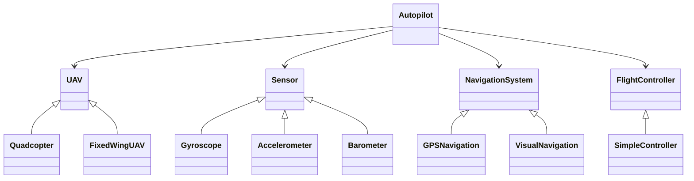

# Контрольная работа № 2

**Дисциплина:** ПО объектов наземной инфраструктуры  
**Тема:** Абстрактные и виртуальные классы в архитектуре БПЛА  
**Вариант:** 1 во всех заданиях  
**Проект:** Control_Work_02_Polymorphism

## 1. Цель и состав решения

Создано приложение на C++17 и Qt Widgets, демонстрирующее наследование, инкапсуляцию и динамический полиморфизм. Расчётные классы отделены от интерфейса; обязательный текстовый вывод выполняется через `qDebug()`. Интерфейс показывает тот же вывод в журнале и дополняет его интерактивными схемами.

| Требование | Реализация |
|---|---|
| Задание 1: Quadcopter и FixedWingUAV | `uav.h`, `uav.cpp`, `run_flight_test(UAV&)` |
| Задание 2: Gyroscope, Accelerometer, Barometer | `sensor.h`, `sensor.cpp`, `check_sensors(const std::vector<Sensor*>&)` |
| Задание 3: GPSNavigation и VisualNavigation | `navigation.h`, `navigation.cpp`, `print_navigation_status(const NavigationSystem&)` |
| Общее интеграционное задание | `autopilot.h`, `autopilot.cpp`, `Autopilot::run_cycle()` |
| Контроллер для интеграции | `controller.h`, `controller.cpp`, `SimpleController` |
| Визуальное представление | `mainwindow.*`, `labview.*` |
| Воспроизводимая консольная демонстрация | `main.cpp`, аргумент `--console` |
| Автоматические проверки | `tests/test_model.cpp`, `tests/test_window.cpp` |

В задании 3 выбран вариант 1 — GPS и визуальная навигация. PID и нечёткий регулятор относятся к другому варианту и не требуются. Для общего задания нужен интерфейс `FlightController`; его конкретная реализация `SimpleController` с коэффициентом 0.5 воспроизводит эталонный результат 25.

## 2. Архитектура и полиморфизм



Базовые классы содержат чисто виртуальные методы и виртуальный деструктор `virtual ~Имя() = default`. Создать объект абстрактного базового класса нельзя; через ссылку или указатель на него можно вызвать реализацию конкретного наследника. Все переопределения помечены `override`: компилятор проверяет совпадение сигнатур.

Изменяемое состояние находится в `private`. Например, готовность сенсора меняется через `set_ready()`, число спутников — через `set_satellites()`. `Position` — предусмотренная заданием структура данных с открытыми координатами.

Универсальные функции не содержат `dynamic_cast` или сравнений конкретных типов. Условия в них проверяют наличие модулей, готовность и корректность данных. Выбор конкретного объекта в интерфейсе происходит до передачи в универсальную функцию и не меняет её алгоритм.

`Autopilot` хранит **невладеющие** указатели: он не создаёт и не удаляет модули. Объекты должны существовать дольше использующего их автопилота. В демонстрации они объявлены раньше него; GUI создаёт локальную конфигурацию, выполняет цикл синхронно и только затем выходит из области видимости. Вектор копируется, но его элементы продолжают ссылаться на исходные сенсоры.

## 3. Задание 1 — летательные аппараты

`UAV` объявляет `takeoff()`, `land()` и `type()`. Универсальная функция выводит тип, вызывает взлёт и посадку и сообщает о завершении.

Результат двух вызовов:

```text
Vehicle: Quadcopter
Quadcopter: vertical takeoff
Quadcopter: vertical landing
Flight test completed
Vehicle: Fixed-wing UAV
Fixed-wing UAV: runway takeoff
Fixed-wing UAV: gliding landing
Flight test completed
```

Различия поведения определяются реализацией виртуальных методов. Анимация дополнительно показывает вертикальный профиль квадрокоптера и наклонный профиль самолётного аппарата.

## 4. Задание 2 — сенсоры

Интерфейс `Sensor` содержит `read()`, `is_ready()` и `name()`. Объекты собраны в `std::vector<Sensor*>`. `check_sensors()` последовательно проверяет указатель, готовность и конечность показания; возвращает общий логический результат для использования автопилотом.

| Сенсор | Контрольное значение | Единица |
|---|---:|---|
| Gyroscope | 1.25 | rad/s |
| Accelerometer | 9.81 | m/s² |
| Barometer | 1012.8 | hPa |

```text
Checking sensors...
Gyroscope: Ready, value=1.25
Accelerometer: Ready, value=9.81
Barometer: Ready, value=1012.8
All sensors are ready
```

После `gyro.set_ready(false)` гироскоп отмечается `Not ready`, а общий статус становится `sensor failure`. Неготовый сенсор не считывается. Прямой вызов его `read()` возвращает NaN как защитное значение. Пустой набор, нулевой указатель или неконечное показание также приводят к отказу.

## 5. Задание 3 — навигация

`NavigationSystem` объявляет `get_position()`, `is_valid()` и `system_name()`.

- `GPSNavigation::is_valid()` возвращает `satellites >= 4 && valid`.
- `VisualNavigation::is_valid()` возвращает состояние `target_tracked`.

Начальная позиция обоих источников: широта 55.75°, долгота 37.61°, высота 150 м. В GPS по умолчанию восемь спутников и установлен флаг валидности; визуальная система сопровождает цель.

```text
Navigation system: GPS
Position: 55.75, 37.61, 150
Status: Valid
```

При трёх спутниках или снятом флаге GPS выводится `Status: Invalid`. Для визуальной системы потеря цели приводит к тому же статусу. `print_navigation_status()` показывает состояние источника; автопилот отдельно проверяет допустимость самих координат. Это разные проверки: готовность источника не гарантирует корректность данных.

## 6. Интеграция — автопилот

Порядок одного `run_cycle()`:

1. Сброс результата предыдущего вызова; проверка указателя на аппарат.
2. Проверка всех сенсоров через общий интерфейс.
3. Проверка указателя навигации и её `is_valid()`.
4. Получение позиции и проверка координат.
5. Проверка указателя контроллера.
6. Вычисление ошибки и управления, проверка конечности результата.
7. Вывод результата и фиксация успешного завершения.

Позиция допустима, если все координаты конечны, широта находится в диапазоне [−90; 90], долгота — [−180; 180], высота неотрицательна. Последнее ограничение соответствует условию учебного задания.

Формулы при целевой высоте 200 м:

```text
error = target_altitude − position.altitude = 200 − 150 = 50 м
output = coefficient × error = 0.5 × 50 = 25
calculate_control(error, 0.1)
```

Пропорциональный регулятор не накапливает состояние; параметр `dt` проверяется, но не участвует в умножении. Выход 25 — условный управляющий сигнал, физическая размерность которого заданием не определена.

Полный штатный вывод реализации (включает подробный обход сенсоров):

```text
Autopilot cycle started
Checking sensors...
Gyroscope: Ready, value=1.25
Accelerometer: Ready, value=9.81
Barometer: Ready, value=1012.8
All sensors are ready
Navigation: GPS
Current altitude: 150 m
Target altitude: 200 m
Altitude error: 50 m
Controller output: 25
Autopilot cycle completed
```

`last_result()` возвращает результат последнего цикла: успех, сообщение, высоту, ошибку и управление. Это позволяет интерфейсу показывать результат без разбора текстового журнала.

## 7. Обязательные сценарии проверки

| № | Входные условия | Ожидаемый результат |
|---|---|---|
| 1 | Все сенсоры готовы, GPS валиден, высота 150 м | Успешное завершение, ошибка 50, управление 25 |
| 2 | Один сенсор не готов | `Autopilot cycle aborted`, `Reason: sensor failure` |
| 3 | GPS невалиден | `Autopilot cycle aborted`, `Navigation data invalid` |
| 4 | `controller == nullptr` | `Autopilot cycle aborted`, `Error: flight controller is not set` |
| 5 | Высота −1 м | `Autopilot cycle aborted`, `Error: invalid navigation position` |

Все пять сценариев доступны в интерфейсе, консольной демонстрации и тестах модели. Дополнительные тесты проверяют нулевые указатели на аппарат, навигацию и сенсор, нечисловые координаты, недопустимые географические диапазоны, переход 3→4 спутника и восстановление после отказа. Замена квадрокоптера на самолётный БПЛА и GPS на визуальную навигацию проверяется без изменения алгоритма автопилота.

Команды проверки приведены в README. Наличие тестов описывает проверяемые свойства; результат конкретной сборки следует оценивать по свежему выводу CTest.

## 8. Визуализация и границы модели

Схемы аппаратов, индикаторы сенсоров, навигационная схема и контур высоты нарисованы программно. Навигационная схема не является географической картой. В журнал попадает реальный `qDebug()` расчётных классов.

Каждое испытание сначала выполняет требуемую проверку, затем воспроизводит иллюстрацию. Движение роторов и профиль полёта не моделируют аэродинамику. Осциллограммы не являются потоком измерений: значения сенсоров постоянны по условию. Изменение высоты во время анимации не запускает дополнительные циклы реального управления; для алгоритма эталонным остаётся результат одиночного вызова в журнале. Анимацию можно приостановить или отключить.

## 9. Краткие ответы для защиты

**Зачем абстрактный класс?** Он задаёт обязательный контракт заменяемого модуля и запрещает создание неполной реализации.

**Почему деструктор виртуальный?** Чтобы удаление наследника через указатель на базовый класс корректно вызывало цепочку деструкторов. В этой работе автопилот сам модули не удаляет.

**Где полиморфизм?** В вызовах виртуальных методов через `UAV&`, `Sensor*`, `const NavigationSystem&` и указатели модулей внутри автопилота.

**Зачем `override`?** Для проверки компилятором, что метод действительно переопределяет базовый, а не случайно создаёт другую перегрузку.

**Как добавить новый сенсор?** Унаследовать `Sensor`, реализовать три метода и передать объект в существующий вектор. Общую проверку менять не требуется.

**Почему проверяется и навигация, и позиция?** Первый шаг проверяет состояние источника, второй — численные данные. Валидный статус не должен пропускать отрицательную высоту или NaN.

**Что происходит после отказа?** Цикл немедленно возвращается с неуспешным результатом; последующие операции не выполняются. Новый вызов заново проверяет состояние модулей.
